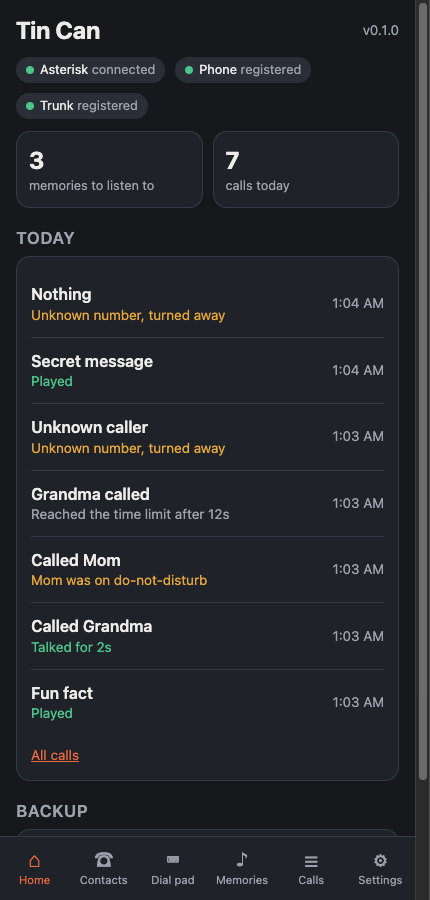
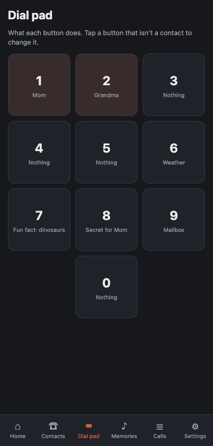
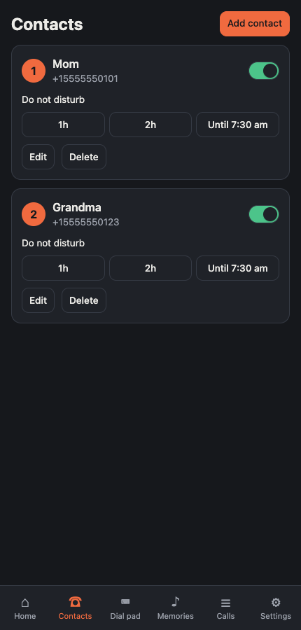
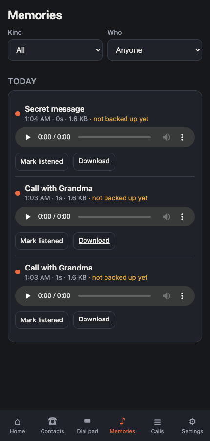

# Tin Can

A "tin can and string" landline for a toddler. An ordinary cheap landline phone, gutted and wired
straight into a Raspberry Pi, that can call a short list of family and friends over the internet,
ring when they call back, and record every call as an audio memory. Memory keys are named speed
dials; extra keys do fun things: hear the weather, learn a fact, leave a secret message for a parent.

Everything runs self-hosted on a Raspberry Pi 4 at home. The only cloud pieces are the ones that
can't be avoided (a phone number on the public phone network) or that protect the memories (off-site
backup of recordings). See [docs/architecture.md](docs/architecture.md).

```
                  ┌───────────────────── Raspberry Pi 4 ─────────────────────┐
 ┌─────────┐ USB  │ ┌─────────┐ SIP/RTP ┌──────────┐  ARI  ┌───────────────┐ │   SIP trunk   ┌──────────┐
 │ handset ├──────┼─┤ baresip ├─────────┤ Asterisk ├───────┤ tincan backend│ ├───────────────┤ provider │──▶ family's
 │ keys    ├─GPIO─┼─────────────────────┼──────────┼───────┤ + parent UI   │ │  (internet)   └──────────┘    phones
 │ speaker │◀─amp─┼─ headphone jack     └────┬─────┘       └───────┬───────┘ │
 └─────────┘      │                          │ recordings          ▼         │
                  │                          ▼                               │
                  │                    /data/recordings  ──▶  off-site backup (rclone)
                  └──────────────────────────────────────────────────────────┘
```

## Repository layout

| Path | What |
|------|------|
| `docs/` | Architecture, decisions (`adr/`), hardware, signal path, API contract, runbooks |
| `hardware/` | The phone teardown, wiring and schematics, bill of materials |
| `firmware/pico/` | The original Pico 2 W experiment (dial/hook sensing). Unused; the Pi's GPIO does this now. |
| `asterisk/` | Asterisk configuration: thin dialplan that hands every call to the backend |
| `backend/` | Python service: call control (ARI), contacts, policies, features, recordings, parent API |
| `ui/` | Parent web app (React + Vite), built into the backend image |
| `deploy/` | Pi bootstrap, Docker Compose, OTA updates, backups, Tailscale |
| `.github/workflows/` | CI: tests, lint, multi-arch image build, release |

## Quick start (developer laptop)

```
mise install          # python, uv, node, pnpm
mise run setup        # install backend + ui deps
mise run test         # backend + ui tests
mise run dev          # backend on :8080 with a fake Asterisk, ui on :5173
```

## Quick start (the Pi)

See [deploy/README.md](deploy/README.md). Short version: flash Raspberry Pi OS Lite 64-bit, run
`deploy/bootstrap.sh` once, then every later update is `mise run release` from your laptop.

## Demo without hardware

`mise run demo` starts the backend against an in-process fake Asterisk, serves the built parent app
on http://localhost:8080 (password `demo`), and drives a scripted day: a fun fact, a call to Grandma
with a recording, a do-not-disturb rejection, an inbound call that hits the time cap, an unknown
caller turned away, and a secret message for Mom.

<p>




</p>

## Status

Experimental branch `tin-can-landline`. The phone is sourced and opened; nothing has been wired
yet. See [hardware/phone-interface-overview.md](hardware/phone-interface-overview.md) for the
hardware path, [docs/roadmap.md](docs/roadmap.md) for the build order and
[docs/first-weekend.md](docs/first-weekend.md) for what to buy and do first.
